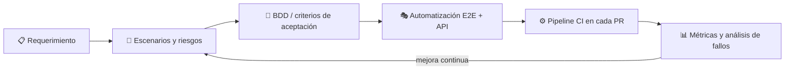

<!-- ============================================================
  PERFIL DE GITHUB - Eliecer Ureche
  Cómo usarlo: crea un repo PÚBLICO llamado exactamente igual a tu usuario
  de GitHub (ej: github.com/TU_USUARIO/TU_USUARIO) y pega este archivo como README.md.
  Reemplaza TU_USUARIO, los enlaces y los valores marcados con [COMPLETAR].
============================================================ -->

<div align="center">


[](https://git.io/typing-svg)

<p>
  <a href="https://www.linkedin.com/in/EliecerUT"></a>
  <a href="mailto:elieceru.job@gmail.com"></a>
  <a href="https://github.com/EliecerUT?tab=repositories"></a>
  
  
</p>

</div>

---

## 👋 Sobre mí

Soy **Ingeniero de Sistemas** (Universidad del Magdalena) y **QA Automation Engineer** en **MAGIC LOG**, una plataforma de logística y carga internacional. Mi trabajo es construir la red de seguridad que permite al equipo desplegar con confianza: suites E2E mantenibles, pruebas de API, y pipelines en CI que se ejecutan en cada cambio.

Me interesa especialmente:

- 🧱 **Arquitectura de frameworks de pruebas**: Page Object Model, capas claras, código reutilizable.
- 🔁 **Estabilidad**: cazar tests inestables (*flaky*) antes de que erosionen la confianza en la suite.
- ⚙️ **CI/CD**: que las pruebas sean parte del flujo de entrega, no un paso aparte.
- 🤖 **IA aplicada al testing**: usar LLMs para diseñar, mantener y analizar pruebas, siempre con criterio humano al final.

```ts
const eliecer = {
  rol: "QA Automation Engineer",
  stack: ["Playwright", "TypeScript", "Cucumber", "Postman", "k6", "GitHub Actions"],
  enfoque: "calidad desde el diseño",
  aprendiendoAhora: ["Arquitectura de frameworks", "BDD avanzado", "Pipelines CI/CD"],
  idiomas: { español: "nativo", inglés: "A2 (en mejora continua)" },
  contacto: "elieceru.job@gmail.com",
};
```

---

## 🛠️ Stack técnico

<div align="center">

**Automatización E2E & BDD**


**API & Performance**


**CI/CD & Control de versiones**


**Lenguajes & Datos**


**Metodologías**


</div>

---

## 💼 Experiencia

### 🧪 QA Engineer · MAGIC LOG S.A.P.I de C.V. (2024 — Presente) · Remoto

> Plataforma de logística y carga internacional: documentos de embarque (MAWB/HAWB), análisis de rentabilidad de embarques, ambientes de staging y despliegue continuo.

| Área | Qué hago | Impacto |
|---|---|---|
| **Automatización E2E** | Diseño suites con Playwright + TypeScript + Cucumber (BDD) usando Page Object Model | Más de 60 casos de pruebas en flujos criticos` |
| **CI/CD** | Integro la ejecución de pruebas en pipelines de GitHub Actions | `Reducción del 90% en tiempos de ejecución de casos de regresión |
| **API Testing** | Diseño y ejecuto colecciones en Postman; reporto y doy seguimiento a defectos | Se detectaron huecos de seguridad en los servicios de obtención de datos (Métodos Get) |
| **Requerimientos** | Analizo requerimientos funcionales y defino escenarios para detectar defectos temprano | Shift-left en el ciclo de desarrollo |
| **IA en QA** | Uso LLMs para apoyar diseño, mantenimiento y análisis de pruebas | Menos tiempo en tareas repetitivas |

---

## 🚀 Proyectos destacados

<!-- IMPORTANTE: publica estos repos ANTES de dejar los enlaces. No enlaces a repos que no existan. -->

<table>
<tr>
<td width="50%" valign="top">

### 🎭 playwright-e2e-framework
Framework E2E de referencia con arquitectura por capas.


- Page Object Model + fixtures personalizados
- Ejecución paralela, reintentos y trazas
- Reporte HTML publicado en GitHub Pages
- Pipeline en cada Pull Request
- Features legibles por negocio y producto
- Tags por suite (smoke / regression)
- Datos de prueba desacoplados

[📂 Ver repositorio](https://github.com/EliecerUT/sauce-demo-qa.git)

## Comming soon

### 🔌 api-testing-playwright-postman
Pruebas de contrato y regresión de API.


- Colecciones Postman + Newman en CI
- Validación de esquemas y códigos de estado
- Escenarios positivos, negativos y de borde

[📂 Ver repositorio](https://github.com/EliecerUT/api-testing-playwright-postman)

</td>
<td width="50%" valign="top">

### ⚡ k6-performance-starter
Plantilla de pruebas de carga con umbrales (*thresholds*).


- Escenarios smoke / load / stress
- Umbrales que rompen el pipeline si se degradan
- Ejecución programada en CI

[📂 Ver repositorio](https://github.com/EliecerUT/k6-performance-starter)

</td>
</tr>
</table>

---

## 🧭 Cómo pienso la calidad



- **Pirámide, no helado**: muchas pruebas rápidas de API, E2E solo para flujos críticos.
- **Una prueba inestable es peor que ninguna**: se arregla o se elimina.
- **Los datos de prueba son parte del diseño**, no un detalle posterior.
- **El reporte debe responder una pregunta**: ¿puedo desplegar o no?

---

## 📈 GitHub en números

<div align="center">


</div>

---

## 🎓 Formación

- 🎓 **Ingeniero de Sistemas** · Universidad del Magdalena · 2019 — 2024
- 📜 **Dominando Playwright con TypeScript: E2E Testing Moderno** · Udemy · 2025
  <br/>ID de credencial: `UC-7ec71f01-e7bc-4aa7-9f18-dfd18c40ce05`

---

## 🌱 En lo que estoy trabajando ahora

- [x] Frameworks E2E con Playwright + TypeScript + POM
- [x] BDD con Cucumber y pipelines en GitHub Actions
- [ ] Despliegue y ejecución de pruebas en CI/CD de punta a punta
- [ ] Arquitectura avanzada de frameworks de pruebas
- [ ] Inglés técnico (A2 → B2)

---

<div align="center">

### 📬 Hablemos

¿Buscas a alguien que automatice con criterio y piense en la calidad como un todo?

[](mailto:elieceru.job@gmail.com)
[](www.linkedin.com/in/eliecer-farid-ureche-0b7660179)


</div>
